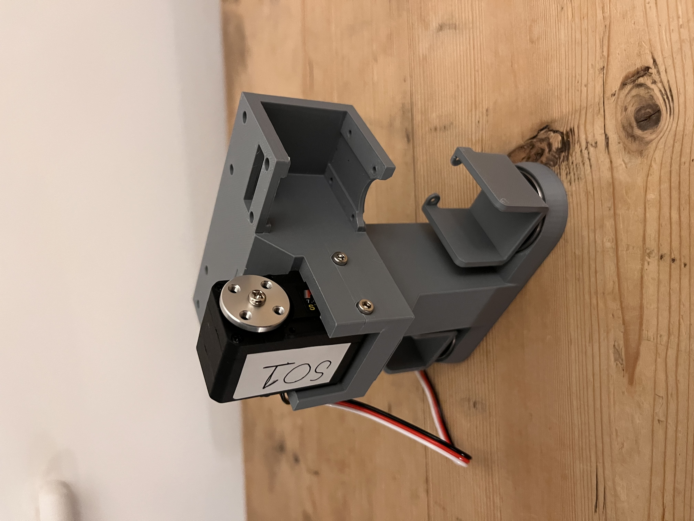
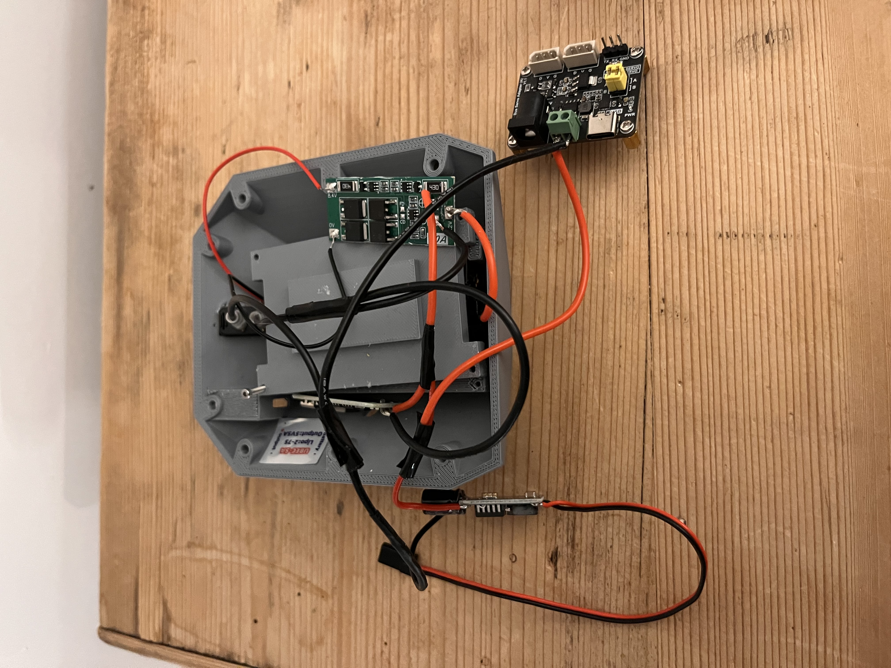
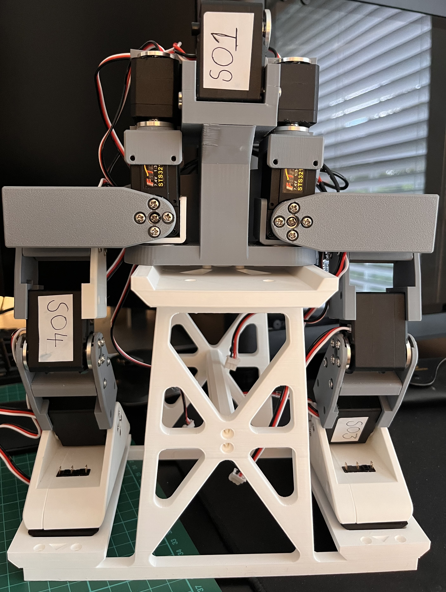
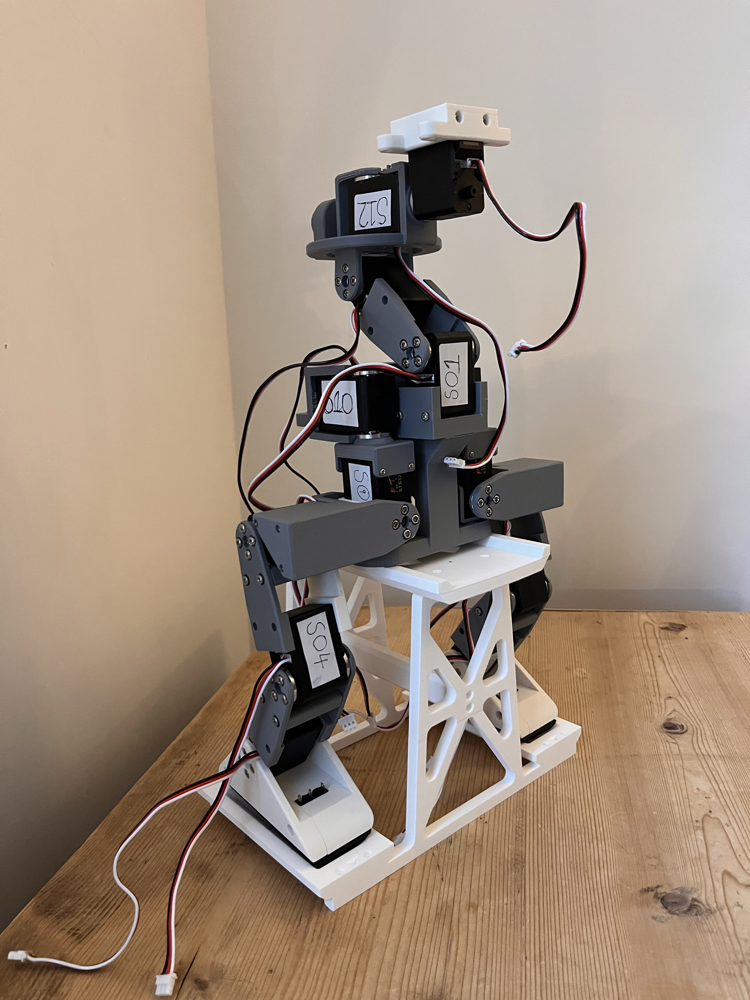
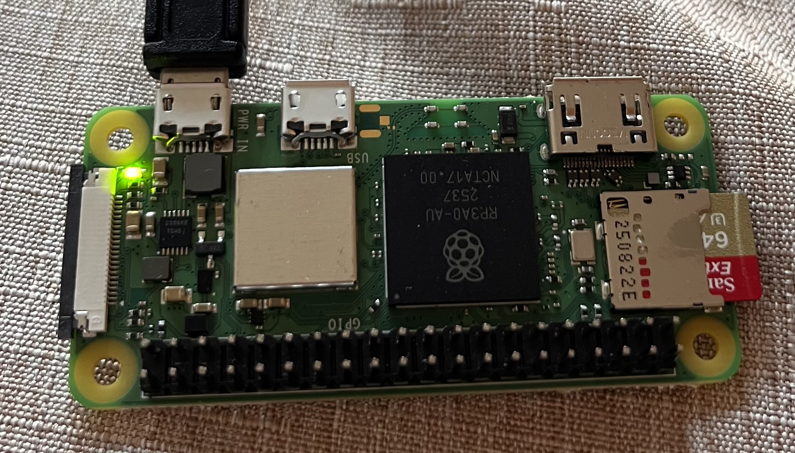

# open-duck-mini-build

Building an open-source humanoid robot while exploring robotics, embedded systems, and AI.

This repository is my build journal for the Open Duck Mini v2: sourcing parts, printing and assembling the robot, documenting calibration, and eventually experimenting with the software stack.

## Build Preview

The main body, leg, neck, and head servo assemblies are complete. These photos follow the build from early servo fitting to the assembled structure:









Latest hardware checkpoint: the replacement Raspberry Pi Zero 2 W with a pre-soldered GPIO header has arrived and is working over SSH. Controller integration is next.



## Attribution

Open Duck Mini is an open-source robotics project by the original project maintainers at [apirrone/Open_Duck_Mini](https://github.com/apirrone/Open_Duck_Mini). This repository is not a fork of the upstream project and does not duplicate the upstream source files. It is a personal build log, workshop notes, shopping tracker, and place for my own modifications or scripts as the build progresses.

Useful upstream links:

- [Open Duck Mini repository](https://github.com/apirrone/Open_Duck_Mini)
- [Open Duck Mini Runtime](https://github.com/apirrone/Open_Duck_Mini_Runtime)
- [Open Duck Mini v2 project listing](https://robotics.growbotics.ai/projects/hardware/open-duck-mini-v2)

## Current Status

Workshop setup and printing are complete enough to move forward. The main servo structure is assembled, laptop servo-chain checks are complete, and the build is now at the Raspberry Pi/controller integration checkpoint.

Printed so far: all required STL prints and optional TPU foot bottoms are complete. The PLA feet have been dry-fitted, and the TPU foot bottoms are ready for final fit checks.

Hardware sourcing is well underway. The foot micro switches, main STS3215 servos, SG90 servos, BNO055 IMU, Waveshare serial bus servo driver boards, main power switch, battery charger, 18650 cells, 8 x 22 x 7 mm bearings, 5V UBEC, XT30 connectors, DC barrel adapters, red/black wire, Loctite 243, 2S BMS/protection boards, a DC barrel power adapter, a 4K HDMI cable, Raspberry Pi support parts, and a Raspberry Pi Zero 2 W have arrived. A compact replacement 2S battery holder has also arrived, fits the reprinted rear panel, and is now wired into a completed 2S power-pack subassembly. Pack voltages, switch operation, the UBEC's switched 5V output, and the raw battery-voltage branch have been checked with a multimeter. The USB-C charging board is wired, but charging still needs a controlled test before regular use.

The servo-controller bench milestone is now complete: the switched 7.4 V branch was measured before connection, the Waveshare controller was connected to the laptop, all 14 STS3215 servo IDs were programmed and power-cycle verified, and the complete S01–S14 chain has responded to read-only status checks. The servos were centred and their horns aligned before fitting; the physical joint-to-ID mapping is recorded and the cables have slack. S09's collision during an assembled centre command has not established an alignment or configuration fault; its cause still needs to be understood before further powered movement.

The replacement Pi Zero 2 W with a pre-soldered header is now working over SSH using the existing microSD installation: Debian 12 (Bookworm), `aarch64`. The existing upstream `v2` runtime checkout and Python 3.11 virtual environment were checked: `mini-bdx-runtime` version `0.0.1` is installed in editable mode and `pip check` reports no broken requirements. Soldering/desoldering the original header was a difficult beginner lesson and damaged it; buying a pre-soldered replacement avoids further header repair for this build. These checks confirm the software setup, not robot hardware operation. The Pi is not yet connected to the Waveshare controller. See the [checkpoint and photo](docs/build-log.md#2026-11-07---replacement-pi-and-runtime-checkpoint).

## Project Progress

Updated: 2026-11-07

Progress is tracked as a practical build estimate rather than an exact percentage. Printing progress is counted from the required printed part quantities in [docs/printing-progress.md](docs/printing-progress.md). The optional TPU foot bottoms are complete as an upgrade to the PLA feet.

```text
Overall build progress   [#######---] 63%
Printing progress        [##########] 100%  49 / 49 required printed parts + TPU feet
```

| Area | Progress | Status |
| --- | ---: | --- |
| Workshop setup | 100% | Core tools, soldering setup, fasteners, inserts, wire, and consumables are ready. |
| 3D printing and fit checks | 100% | All required STL prints and optional TPU foot bottoms are complete. PLA feet have been dry-fitted. |
| Hardware sourcing | 85% | Main hardware is received, including the replacement Pi Zero 2 W with a pre-soldered header and the installed microSD card. Confirm the USB OTG adapter/data cable for the Pi-to-Waveshare connection. |
| Mechanical assembly | 60% | The main body, leg, neck, and head servo assemblies are fitted and the S01–S14 servo chain is routed. Final cable dressing, clearances, joint limits, and calibration remain. |
| Electronics and power | 55% | The 2S battery pack, BMS, switch, USB-C charging board, UBEC, switched 5V output, raw 7.4V branch, Waveshare controller, and complete servo chain have been connected and checked. The loaded servo supply still needs to be tested only with a fully charged pack and safe mechanical loads. |
| Calibration and first motion | 5% | IDs are programmed and read-only status checks are working. Per-joint zero offsets, safe limits, torque tests, and coordinated motion have not yet been completed. |
| Software and runtime experiments | In progress | Replacement Pi boots and accepts SSH on Debian 12 / aarch64. Existing v2 runtime installation and dependency consistency are verified; USB controller detection, hardware integration, and runtime operation remain untested. |

Current next steps:

1. Consult the [v2 wiring diagram](https://github.com/apirrone/Open_Duck_Mini/blob/v2/docs/open_duck_mini_v2_wiring_diagram.png) before making the Pi-to-controller connection. Shut down the Pi and disconnect power before changing wiring.
2. Connect the Pi's micro-USB **USB** data port through an OTG host adapter and USB data cable to the Waveshare **USB-C** port. Keep the Pi on a separate suitable 5V supply via **PWR IN** and the servo battery switched off for initial USB detection; the servo chain stays on the Waveshare, not the Pi GPIO header.
3. Identify the controller's actual Linux serial device without sending servo commands. The Mac device name is not the Pi device name.
4. Review the runtime's S01–S14 joint mapping, reference positions, offsets, limits, and any automatic torque/pose commands. Start powered controller integration with read-only servo checks, not a movement demo.
5. Complete the remaining electronics checks, including IMU/foot-switch wiring and controlled USB-C charging. Plan supported movement only after the startup pose, supply under load, and S09's clearance are understood; do not repeat bulk centring or arbitrary individual midpoint commands on the assembled robot.

These are verification steps, not a decision to redo horn alignment or change servo IDs. The Pi itself does not prevent mechanical collisions, and smaller movement increments cannot make an unreachable target safe.

Progress notes: update this section whenever printing, sourcing, assembly, electronics, calibration, or software progress changes.

## Repository Layout

```text
.
├── README.md
├── bom/
│   └── phase-1.csv
├── cad/
│   └── modified-parts/
├── docs/
│   ├── build-log.md
│   ├── phase-1-workshop.md
│   ├── printing-progress.md
│   └── roadmap.md
├── photos/
│   ├── hardware/
│   ├── phase-1-tools/
│   └── printing/
└── scripts/
```

## Documentation

- [Phase 1 Workshop Setup](docs/phase-1-workshop.md)
- [Printing Progress Tracker](docs/printing-progress.md)
- [Build Log](docs/build-log.md)
- [Roadmap](docs/roadmap.md)
- [Hardware Sourcing Tracker](docs/hardware-sourcing.md)
- [Phase 1 BOM Checklist](bom/phase-1.csv)

## Principles

- Keep attribution clear and link back to the upstream project.
- Document the build process honestly, including mistakes and fixes.
- Avoid copying upstream files unless I am intentionally modifying or extending them.
- Keep purchases phased so the project stays manageable.
- Prefer small, useful commits that show the engineering journey.
