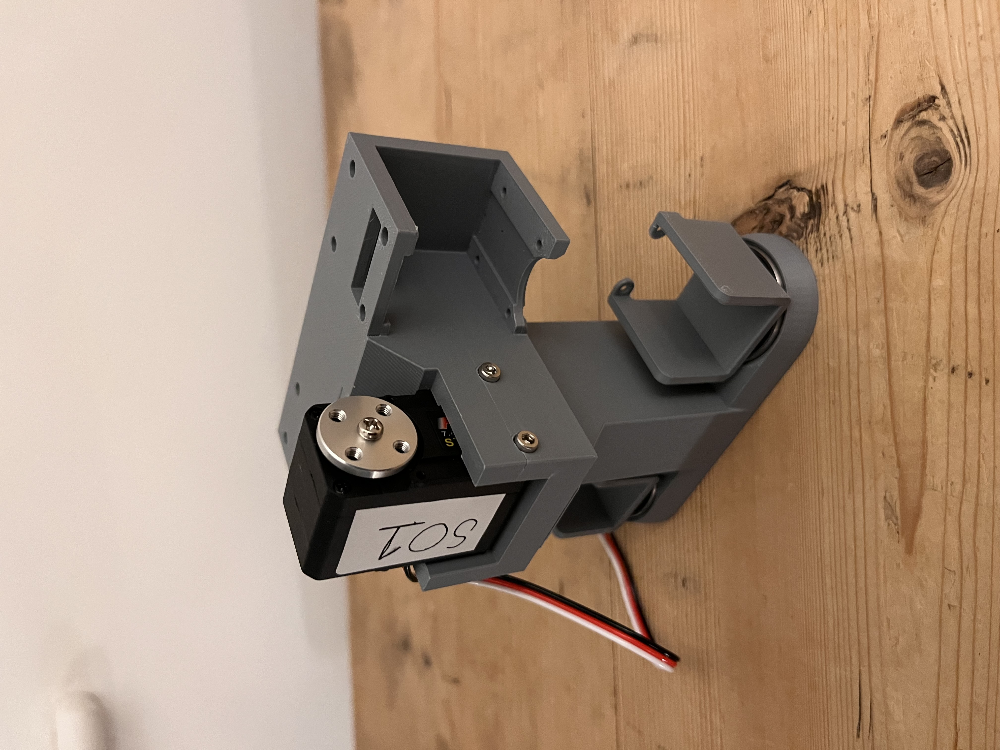
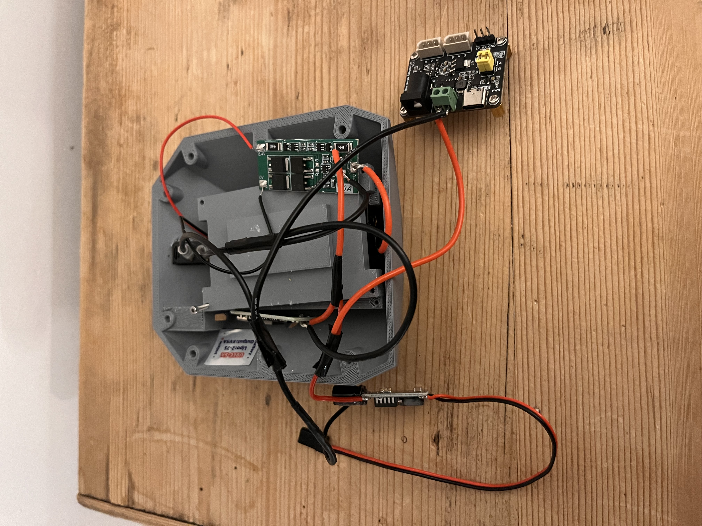
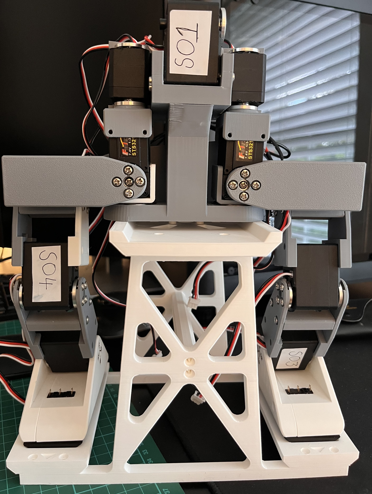
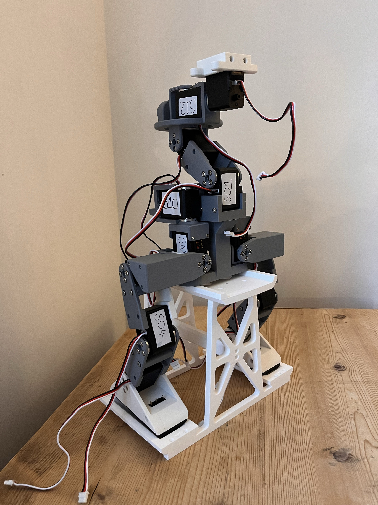

# open-duck-mini-build

Building an open-source humanoid robot while exploring robotics, embedded systems, and AI.

This repository is my build journal for the Open Duck Mini v2: sourcing parts, printing and assembling the robot, documenting calibration, and eventually experimenting with the software stack.

## Build Preview

Early mechanical assembly is now underway. These photos show the first main body and servo-fit progress:









## Attribution

Open Duck Mini is an open-source robotics project by the original project maintainers at [apirrone/Open_Duck_Mini](https://github.com/apirrone/Open_Duck_Mini). This repository is not a fork of the upstream project and does not duplicate the upstream source files. It is a personal build log, workshop notes, shopping tracker, and place for my own modifications or scripts as the build progresses.

Useful upstream links:

- [Open Duck Mini repository](https://github.com/apirrone/Open_Duck_Mini)
- [Open Duck Mini Runtime](https://github.com/apirrone/Open_Duck_Mini_Runtime)
- [Open Duck Mini v2 project listing](https://robotics.growbotics.ai/projects/hardware/open-duck-mini-v2)

## Current Status

Phase 1 workshop setup is complete enough to move forward. The build is now past printing and into fit checks plus hardware sourcing.

Printed so far: all required STL prints and optional TPU foot bottoms are complete. The PLA feet have been dry-fitted, and the TPU foot bottoms are ready for final fit checks.

Hardware sourcing is well underway. The foot micro switches, main STS3215 servos, SG90 servos, BNO055 IMU, Waveshare serial bus servo driver boards, main power switch, battery charger, 18650 cells, 8 x 22 x 7 mm bearings, 5V UBEC, XT30 connectors, DC barrel adapters, red/black wire, Loctite 243, 2S BMS/protection boards, a DC barrel power adapter, a 4K HDMI cable, Raspberry Pi support parts, and a Raspberry Pi Zero 2 W have arrived. A compact replacement 2S battery holder has also arrived, fits the reprinted rear panel, and is now wired into a completed 2S power-pack subassembly. The BMS, rocker switch, USB-C charging board, UBEC, switched 5V output, and raw 7.4V branch have been tested with a multimeter; USB-C charging still needs a controlled test before regular use.

The servo-controller bench milestone is now complete: the switched 7.4 V branch was measured before connection, the Waveshare controller was connected to the laptop, all 14 STS3215 servo IDs were programmed and power-cycle verified, and the complete S01–S14 chain has responded to read-only status checks. The next milestone is controlled per-joint calibration; raw midpoint commands must not be sent to assembled joints because their mechanical zero and travel limits differ.

## Project Progress

Updated: 2026-10-10

Progress is tracked as a practical build estimate rather than an exact percentage. Printing progress is counted from the required printed part quantities in [docs/printing-progress.md](docs/printing-progress.md). The optional TPU foot bottoms are complete as an upgrade to the PLA feet.

```text
Overall build progress   [#######---] 63%
Printing progress        [##########] 100%  49 / 49 required printed parts + TPU feet
```

| Area | Progress | Status |
| --- | ---: | --- |
| Workshop setup | 100% | Core tools, soldering setup, fasteners, inserts, wire, and consumables are ready. |
| 3D printing and fit checks | 100% | All required STL prints and optional TPU foot bottoms are complete. PLA feet have been dry-fitted. |
| Hardware sourcing | 85% | STS3215 and SG90 servos, BNO055 IMU, Waveshare serial bus servo driver boards, main power switch, foot switches, cells, charger, bearings, UBEC, BMS boards, connectors, power accessories, GPIO headers, compact battery holder, power-pack wiring, and Raspberry Pi Zero 2 W are received/complete. USB-C charging controlled test and Raspberry Pi runtime setup remain outstanding. |
| Mechanical assembly | 60% | The main body, leg, neck, and head servo assemblies are fitted and the S01–S14 servo chain is routed. Final cable dressing, clearances, joint limits, and calibration remain. |
| Electronics and power | 55% | The 2S battery pack, BMS, switch, USB-C charging board, UBEC, switched 5V output, raw 7.4V branch, Waveshare controller, and complete servo chain have been connected and checked. The loaded servo supply still needs to be tested only with a fully charged pack and safe mechanical loads. |
| Calibration and first motion | 5% | IDs are programmed and read-only status checks are working. Per-joint zero offsets, safe limits, torque tests, and coordinated motion have not yet been completed. |
| Software and runtime experiments | 0% | Not started. |

Current next step: keep torque disabled, recharge the pack, and perform a final read-only status check across IDs 1–14. Then inspect S09’s hip linkage and define per-joint zero and travel limits. Use the upstream pre-assembly motor-zero procedure as the reference, but do not send a universal `2048` target to an assembled joint. Do not use the UBEC 5V output for STS3215 servo power.

Progress notes: update this section whenever printing, sourcing, assembly, electronics, calibration, or software progress changes.

## Repository Layout

```text
.
├── README.md
├── bom/
│   └── phase-1.csv
├── cad/
│   └── modified-parts/
├── docs/
│   ├── build-log.md
│   ├── phase-1-workshop.md
│   ├── printing-progress.md
│   └── roadmap.md
├── photos/
│   ├── hardware/
│   ├── phase-1-tools/
│   └── printing/
└── scripts/
```

## Documentation

- [Phase 1 Workshop Setup](docs/phase-1-workshop.md)
- [Printing Progress Tracker](docs/printing-progress.md)
- [Build Log](docs/build-log.md)
- [Roadmap](docs/roadmap.md)
- [Hardware Sourcing Tracker](docs/hardware-sourcing.md)
- [Phase 1 BOM Checklist](bom/phase-1.csv)

## Principles

- Keep attribution clear and link back to the upstream project.
- Document the build process honestly, including mistakes and fixes.
- Avoid copying upstream files unless I am intentionally modifying or extending them.
- Keep purchases phased so the project stays manageable.
- Prefer small, useful commits that show the engineering journey.
